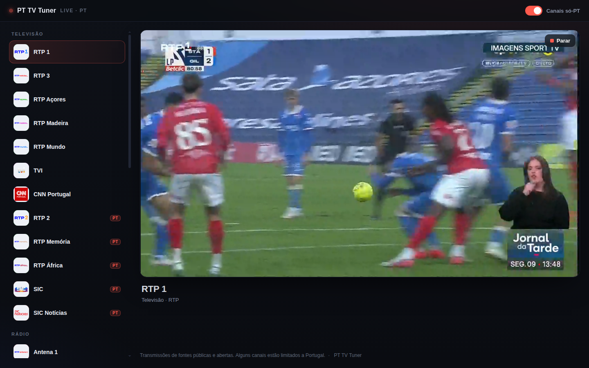

# PT TV Tuner

A sleek, modern web player for **live Portuguese TV and radio**: twelve television channels and twenty radio stations, packaged as a self-contained Docker stack.



It is **a player, not a host**: the app fetches publicly available live streams from the broadcasters' own endpoints and plays them in the browser. No media is stored or served from the project.

## What it does

- **Live TV**: twelve channels, RTP 1, 2 and 3, Açores, Madeira, Mundo, Memória and África, plus TVI, CNN Portugal, SIC and SIC Notícias.
- **Live radio**: twenty stations, the RTP radio family (Antena 1/2/3, the Açores and Madeira relays, RTP Mundo Rádio, RTP África Rádio, Lusitânia, Fado, Jazzin, Ópera, Zig Zag and RTP Vida) plus **Rádio Comercial, M80, Smooth FM, Cidade FM, Rádio Observador and TSF**.
- **"Canais só-PT" toggle**: shows or hides the six channels that expect a Portuguese connection (RTP 2, RTP Memória, RTP África, SIC and SIC Notícias on television, and RTP Vida on radio). It is on by default so the whole line-up is visible, and every marked entry carries a PT badge. Whether a marked channel plays depends on the host's egress, so the player explains a refusal instead of failing silently. RTP 2 has been observed playing from the UK while SIC and SIC Notícias refused.
- **Stop anytime**: the red **■ Parar** button on the player (or `Esc`) ends the stream and returns to channel selection.
- Responsive, dark, app-like UI. Keyboard `↑`/`↓` switches channels.
- Resilient playback: native HLS on Safari/iOS, [hls.js](https://github.com/video-dev/hls.js) everywhere else.

## Quick start

Requires Docker with the Compose plugin.

```bash
docker compose up -d --build
```

Open <http://localhost:8090>.

To use a different port:

```bash
WEB_PORT=9090 docker compose up -d --build
```

## How it works

Three small services:

| Service | Role |
| --- | --- |
| `web` | nginx serving the built React app and reverse-proxying stream routes to the proxy. |
| `proxy` | A zero-dependency Node service that resolves a channel to its HLS playlist, fetches it with the headers broadcasters expect, rewrites every child URL back through itself, and streams segments through. |
| `landing` | nginx serving the static landing page on its own port, so the project has a front door that is not the README. |

The proxy exists because browsers cannot set the `Referer` / `User-Agent` some broadcasters require, and many streams do not send CORS headers. Routing everything through the same origin removes both problems. It also keeps the real source URLs server-side.

```
browser ──▶ nginx (/ , /channels , /stream/:id , /seg) ──▶ proxy ──▶ broadcaster CDN
```

## Adding or changing channels

Everything lives in [`data/channels.json`](data/channels.json). Each entry:

```json
{
  "id": "rtp1",
  "name": "RTP 1",
  "type": "tv",
  "group": "RTP",
  "region": "world",
  "source": "https://streaming-live.rtp.pt/liverepeater/smil:rtp1HD.smil/playlist.m3u8"
}
```

- `type`: `"tv"` or `"radio"`.
- `region`: `"world"` (always shown) or `"pt"` (hidden behind the PT-only toggle).
- `source`: an HLS (`.m3u8`) URL, or a playlist URL that points to one.

The proxy reads this file at start-up; restart the stack after editing it:

```bash
docker compose restart proxy
```

## Configuration

| Variable | Default | Meaning |
| --- | --- | --- |
| `WEB_PORT` | `8090` | Host port for the web UI (bound to `127.0.0.1`). |
| `WEB_BIND` | `127.0.0.1` | Host interface for the web UI. |
| `LANDING_PORT` | `8091` | Host port for the landing page (bound to `127.0.0.1`). |
| `LANDING_BIND` | `127.0.0.1` | Host interface for the landing page. |
| `ALLOW_HOSTS` | `rtp.pt,iol.pt,impresa.pt,githubusercontent.com,bauermedia.pt,sharp-stream.com,streamtheworld.com,tsf.pt` | Comma-separated domains the proxy may fetch, matched on the host or a subdomain (SSRF guard). Add a broadcaster's domain here before using one of its streams. |

## Legal & responsible use

This project does **not** host, store or redistribute any media. It is a player that streams content from publicly reachable broadcaster endpoints, the same way a browser or media player does. The streams and their content remain the property of the broadcasters and are subject to their terms of service; some are geo-restricted.

Use it for **personal viewing**. Do not operate a public relay that re-streams broadcaster content to third parties, and do not use it to circumvent geographic restrictions you are not entitled to bypass. If you add channels, make sure you have the right to access them from where you run the stack.

Channel logos under `web/public/logos/` are the trademarks of their respective broadcasters, included solely to identify each channel; they are not part of this project's branding.

## License

MIT licence. See [LICENSE](LICENSE).
